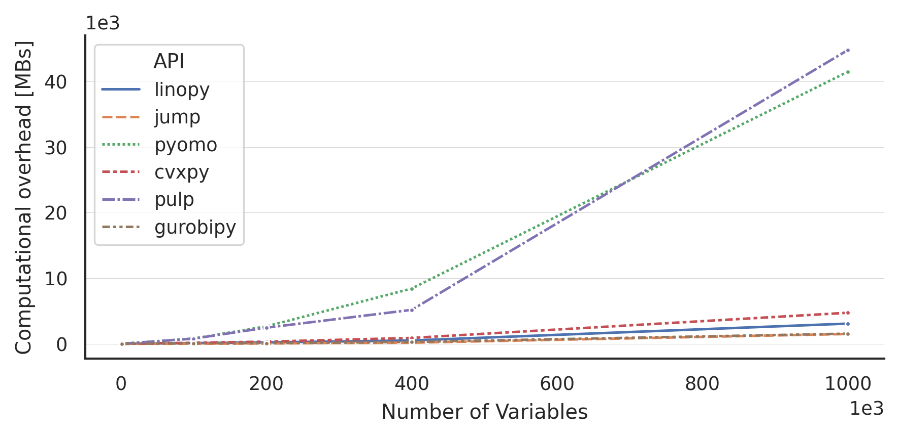

# Features

**linopy** is heavily based on
[xarray](https://github.com/pydata/xarray) which allows for many
flexible data-handling features:

- Define (arrays of) continuous or binary variables with
    **coordinates**, e.g. time, consumers, etc.
- Apply **arithmetic operations** on the variables like adding,
    subtracting, multiplying with all the **broadcasting** potentials of
    xarray
- Apply **arithmetic operations** on the **linear expressions**
    (combination of variables)
- **Group terms** of a linear expression by coordinates
- Get insight into the **clear and transparent data model**
- **Modify** and **delete** assigned variables and constraints on the
    fly
- Use **lazy operations** for large linear programs with
    [dask](https://dask.org/)
- Choose from **different commercial and non-commercial solvers**
- Fast **import and export** a linear model using xarray's netcdf IO
- Support for **GPU-accelerated solving** for large-scale problems
- Support of various solvers
    - [Cbc](https://projects.coin-or.org/Cbc)
    - [GLPK](https://www.gnu.org/software/glpk/)
    - [HiGHS](https://highs.dev/)
    - [SCIP](https://www.scipopt.org/)
    - [MindOpt](https://solver.damo.alibaba.com/doc/en/html/index.html)
    - [Gurobi](https://www.gurobi.com/)
    - [Xpress](https://www.fico.com/en/fico-xpress-trial-and-licensing-options)
    - [Cplex](https://www.ibm.com/de-de/analytics/cplex-optimizer)
    - [MOSEK](https://www.mosek.com/)
    - [COPT](https://www.shanshu.ai/copt)
    - [Knitro](https://www.artelys.com/solvers/knitro/)
    - [cuOpt](https://docs.nvidia.com/cuopt/) (GPU-accelerated)
    - [cuPDLPx](https://github.com/MIT-Lu-Lab/cuPDLPx) (GPU-accelerated)

## Comparison with other tools

linopy formulates models faster and with less memory than most Python
modelling frameworks. See the [benchmark](../user-guide/benchmark.md) and the
[syntax comparison](../user-guide/syntax.md) for details.

